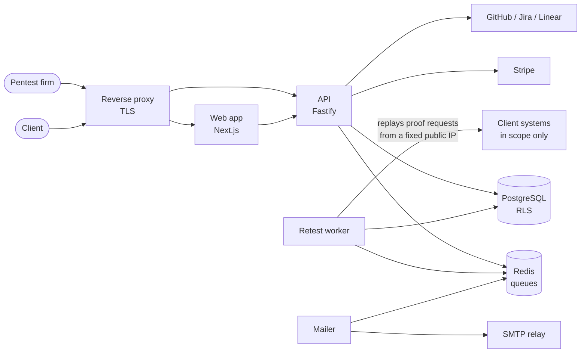

# Closeout — Architecture

How [Closeout](https://getcloseout.tech) works under the hood: the architecture, the remediation workflow, the retest engine and the security model behind them.

This repository is documentation only. It contains no source code.

## What Closeout is

A pentest doesn't end when the report is delivered. Findings still have to be fixed, the fixes have to be verified, and the client usually wants proof that it happened. Today that work runs on PDFs, spreadsheets, email threads and manual retests.

Closeout is a SaaS platform for pentest firms that covers that phase:

- **Client portal.** The client sees the live status of every finding and downloads the report, instead of working from a static PDF.
- **Automated retests.** When the client marks a fix as ready, Closeout replays the original proof request against the target, but only inside the scope and testing window the client authorised.
- **Human confirmation.** A retest can suggest a finding is fixed; only a tester can close it.
- **Regression checks.** Verified findings can be re-checked on a schedule, and reopen automatically if the issue comes back.
- **Attestations.** A verifiable remediation letter for the end client, tied to the exact report version it refers to.
- **Integrations.** Import from Burp Suite (including a Burp extension), Nuclei, SysReptor, Ghostwriter, CSV and JSON; sync tickets to GitHub, Jira and Linear.

## System overview

Five processes, each with only the access it needs:

| Component | Role | Can reach |
|---|---|---|
| Web | UI for firms and clients | API |
| API | Business logic, auth, validation | Database, queues, Stripe, issue trackers |
| Retest worker | Replays proof requests against client systems | Database (restricted role), queues, the internet |
| Mailer | Sends notifications | Queues, SMTP relay |
| Database / Redis | Storage and job queues | Nothing outside the internal network |

More detail in [docs/architecture.md](docs/architecture.md).

## Documentation

| Document | What it covers |
|---|---|
| [Architecture](docs/architecture.md) | Components, network segmentation, deployment hardening |
| [Finding lifecycle](docs/finding-lifecycle.md) | Every state a finding goes through, and who moves it |
| [Retest engine](docs/retest-engine.md) | How a retest runs and how it avoids becoming an attack proxy |
| [Tenancy and data protection](docs/tenancy-and-data-protection.md) | Tenant isolation, encryption, what each component can see |
| [Security model](docs/security-model.md) | Threat model and the controls behind each threat |
| [Design decisions](docs/decisions/) | The reasoning behind the less obvious choices |

## Stack

TypeScript, Node.js, Fastify, Next.js, PostgreSQL, Redis (BullMQ), Docker. Payments through Stripe.

## Contact

- Product: https://getcloseout.tech
- Security issues: see https://getcloseout.tech/security and `/.well-known/security.txt`

---

© Closeout. All rights reserved. This repository documents a proprietary product; no licence is granted to its contents or to the software it describes.
