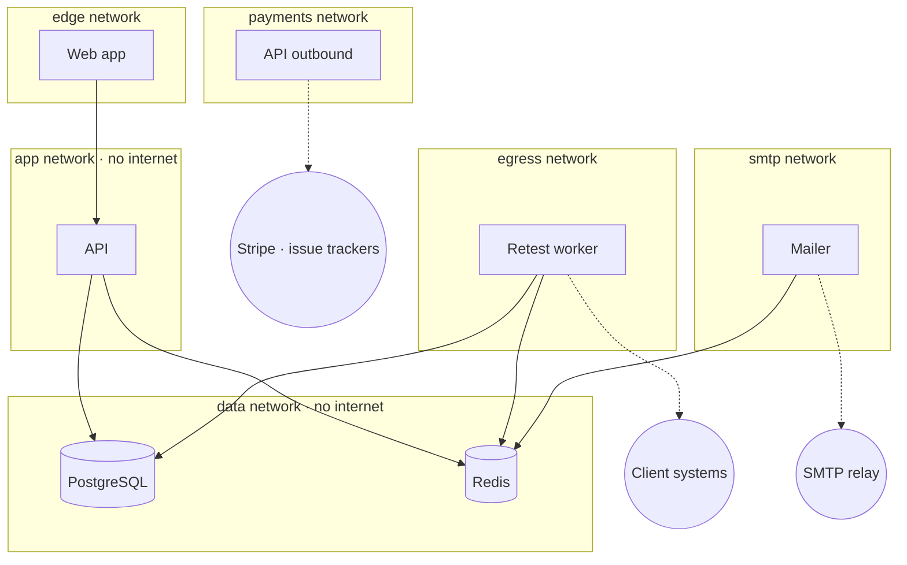

# Architecture

Closeout stores unremediated vulnerabilities belonging to other companies, and it sends requests to their systems. A breach would hand an attacker a map of open holes at every customer. The architecture starts from that assumption: every component is designed as if a neighbouring one were already compromised.

## Components

- **Web** (Next.js) serves the marketing site, the firm app, the client portal and public attestation pages.
- **API** (Fastify) holds all business logic: authentication, validation, plan limits, the finding lifecycle and the audit log.
- **Retest worker** pulls retest jobs from a queue and replays proof requests against client systems.
- **Mailer** turns queued notifications into email. It has no database access and no encryption keys.
- **PostgreSQL** is the source of truth. **Redis** holds job queues only, with no persistence: queues can be rebuilt from database state.

All backend processes run from the same image with different entry points, so there is one artifact to build, scan and ship.

## Network segmentation

The segmentation follows one rule: **the component that touches attacker-influenced data is the one with the least reach.**

The retest worker is the only process that must talk to arbitrary hosts on the internet, and the only one that parses responses from systems Closeout doesn't control. So it sits on its own egress network, **cannot reach the API**, and connects to the database with a dedicated role that has column-level permissions only.

| Network | Members | Internet |
|---|---|---|
| edge | Web | Inbound through the reverse proxy |
| app | Web → API | No |
| data | API, worker, mailer → PostgreSQL, Redis | No |
| egress | Worker | Outbound, from a fixed public IP |
| smtp | Mailer | Outbound to the SMTP relay |
| payments | API | Outbound to Stripe and issue trackers |

The worker's public IP is published on the [security page](https://getcloseout.tech/security) so clients can allowlist it, and so every request Closeout sends is attributable.

## Secrets per process

Each process receives only the secrets it uses. The mailer, for example, gets queue and SMTP credentials and nothing else, so a compromised mailer can't read the database or decrypt evidence. The worker can decrypt proof requests, because it has to replay them, but it can't read users, sessions or the audit log.

## Container hardening

Every service runs with:

- a read-only root filesystem, with a small `noexec` tmpfs;
- all Linux capabilities dropped and `no-new-privileges`;
- a non-root user, in a minimal image without a package manager;
- CPU and memory limits.

Redis requires a password and refuses to start without one; dangerous administrative commands are disabled.

## Delivery pipeline

Every change goes through CI before it can be deployed:

- type checking, unit tests and an end-to-end test of the full remediation loop;
- dependency audit and automated dependency updates;
- secret scanning, static analysis (SAST), and container image and infrastructure-as-code scanning.
