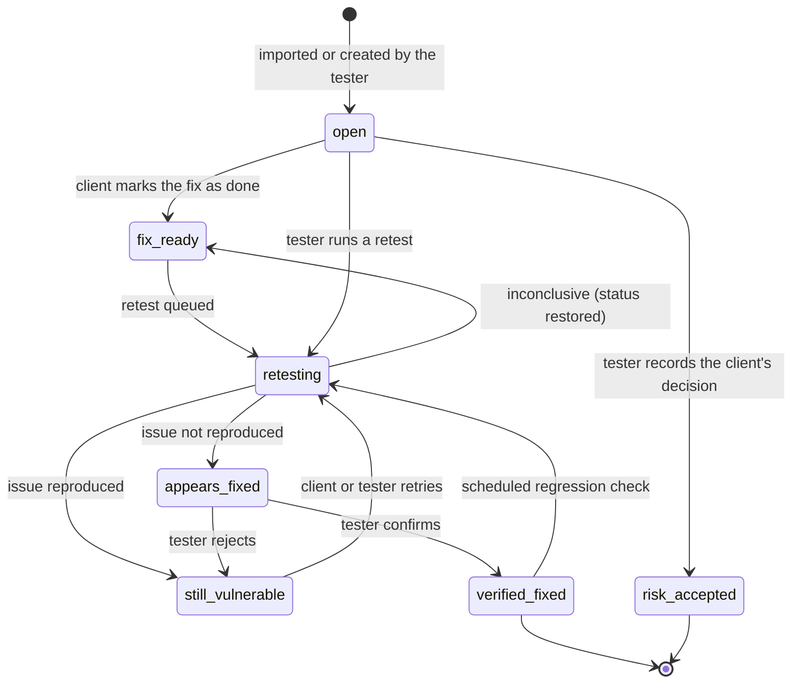

# Finding lifecycle

Every finding in Closeout has a status, and every change of status is recorded in an append-only audit log: who did it, when, and from where.

## States

| Status | Meaning | Who sets it |
|---|---|---|
| **open** | Reported, not yet fixed | Tester (manually or by import) |
| **fix_ready** | The client says it's fixed | Client, from the portal |
| **retesting** | A retest is running | Closeout |
| **still_vulnerable** | The retest reproduced the issue | Closeout, or the tester rejecting a retest |
| **appears_fixed** | The retest didn't reproduce it; waiting for a human | Closeout |
| **verified_fixed** | A tester has confirmed the fix | Tester only |
| **risk_accepted** | The client accepts the risk instead of fixing it | Tester, on the client's behalf |

## Rules worth noting

**Only definitive results move a finding.** If a retest is inconclusive (the target is down, rate-limits us, or requires authentication that has expired), the finding goes back to the status it had before. Inconclusive never becomes "fixed". See [ADR 0001](decisions/0001-inconclusive-is-never-fixed.md).

**Machines suggest, humans decide.** `appears_fixed` is as far as automation goes. Moving a finding to `verified_fixed` always takes a tester's explicit confirmation. See [ADR 0002](decisions/0002-human-confirms-every-closure.md).

**Regression checks don't need re-confirmation.** For verified findings, an engagement can schedule periodic re-checks (weekly or monthly). A passing check leaves the finding verified; a check that reproduces the issue reopens it as `still_vulnerable`.

**Fix-ready triggers a retest automatically**, when the finding has a proof request and a matcher (the rule that defines what "still vulnerable" looks like). Findings without one wait for the tester.

## What the client sees

The client portal shows the same statuses in real time, the history of retests for each finding, and the report itself. When everything is closed, the firm can issue an attestation letter that cites the exact report version by its SHA-256 hash.

If the engagement is linked to an issue tracker (GitHub, Jira or Linear), each status change is mirrored to the corresponding ticket. Tickets carry the finding's description and a link to the portal, never the proof request.
