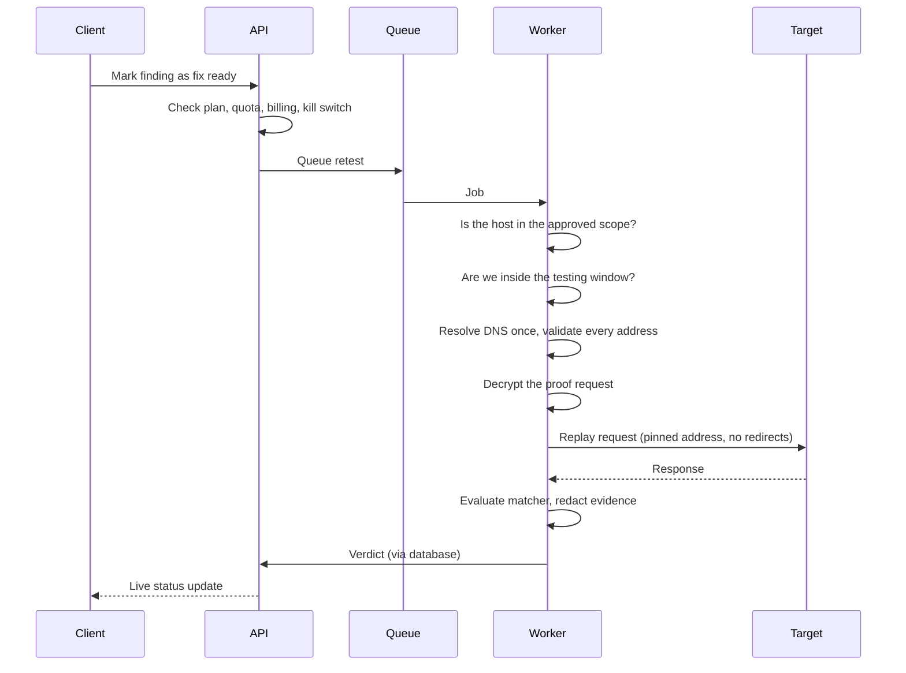

# Retest engine

A retest replays the original proof request for a finding against the client's system, and checks whether the response still shows the vulnerability.

That makes the retest engine the most dangerous part of Closeout. It is, by design, a service that sends attacker-crafted HTTP requests to hosts chosen by its users. Without strict controls it would be an SSRF vector into Closeout's own infrastructure, or a free attack proxy pointed at anyone's systems.

## How a retest runs

## Authorisation: scope and testing window

Every engagement has a **scope** (the hosts that may be tested) and a **testing window** (the dates during which testing is allowed). Both are entered by the firm and **acknowledged by the client**, and that acknowledgement is audited along with the client's IP address. Retests only run for acknowledged engagements, and the scope can't be widened after the fact.

Before every single request, the worker checks again that the target host is in scope and that the current time is inside the window. Findings imported with hosts outside the scope are kept, but never replayed.

## Network controls

- **DNS is resolved once**, and every returned address is validated. The connection is then pinned to those addresses, so a DNS rebinding attack can't swap in an internal address between the check and the request.
- **Private, loopback, link-local and cloud metadata ranges are always blocked.**
- **Redirects are never followed.** A redirect is just a response to evaluate, not an instruction.
- **Response bodies and request durations are capped.**
- **Rate limit per target host**, shared across all workers, so Closeout can never hammer a client's system.
- **Kill switch per firm**: a firm can stop all its retests at once.
- **A single, published egress IP**, so clients can allowlist Closeout and attribute every request to it.

The network layer adds a second wall: the worker's network segment can't reach Closeout's own internal services.

## Deciding the verdict

Each finding with a proof request has a **matcher**: rules that describe what a still-vulnerable response looks like (status code, body pattern, header pattern, or response time for time-based issues). Rules can be combined with *all* or *any*.

| Result | Verdict |
|---|---|
| Matcher matches | `still_vulnerable` |
| Matcher doesn't match, on a clean response | `appears_fixed` |
| 401, 403, 407, 408, 429 or 5xx | `inconclusive` |
| Timeout, connection or DNS failure | error (inconclusive) |
| Out of scope or blocked address | blocked, never sent |

User-supplied regular expressions run under a timeout, so a malicious pattern can't stall the worker.

## Handling evidence

- Proof requests are stored encrypted (see [tenancy and data protection](tenancy-and-data-protection.md)) and are only decrypted inside the worker, at the moment of replay.
- The API never returns stored header values, only header names. A tester can see *that* a request carries a session cookie, not the cookie.
- Response evidence is redacted before it is stored, and kept as a short excerpt.
- Each retest records the IP address the request was actually sent to.
