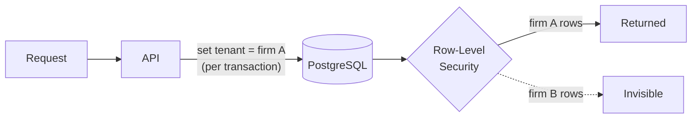
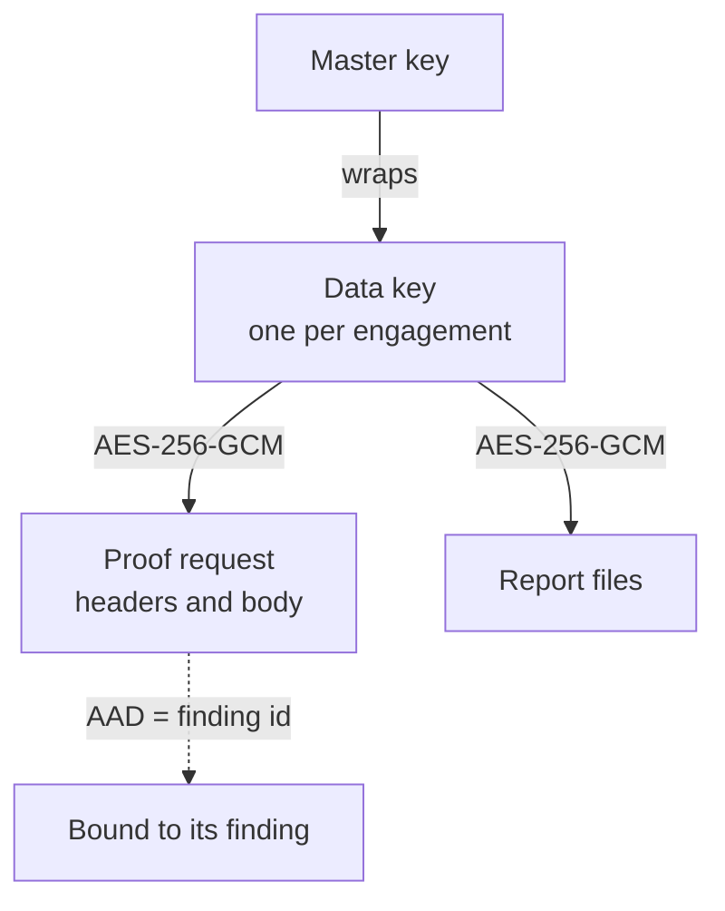

# Tenancy and data protection

## Tenant isolation

Every pentest firm on Closeout is a tenant. Isolation between tenants is enforced **in the database**, not only in application code.

- **Row-Level Security** is enabled on every table that holds tenant data.
- The API connects with a role that can only see rows for the tenant set at the start of each transaction.
- **It fails closed**: a transaction with no tenant set sees no rows at all.
- Anything that belongs to another firm returns *not found*, never *forbidden*, so its existence isn't revealed either.

The single operation that has to look across tenants is the scheduled regression sweep. It goes through a narrow database function that returns only identifiers. Each regression retest is then created inside its firm's own tenant context, with the usual plan, billing and scope checks.

## Separate database roles

Different processes use different database roles:

| Role | Used by | Can |
|---|---|---|
| Authentication | API (sign-in, sessions) | Read and write identity data |
| Application | API (everything else) | Tenant data, filtered by RLS |
| Worker | Retest worker | Read what a retest needs and write results. Column-level grants: no access to users or sessions, can't edit findings' content or the audit log |

The mailer has no database role at all.

## Encryption

Proof requests contain real credentials: session cookies, API keys, authorisation headers taken from the client's systems. They get envelope encryption:

- **Each engagement has its own data key**, stored only wrapped by a master key.
- Proof requests and report files are sealed with **AES-256-GCM** under that key.
- The ciphertext is **bound to its record** (as additional authenticated data), so a sealed blob copied onto another finding fails to decrypt instead of leaking.
- Issue tracker credentials are sealed under the master key and bound to their integration record. They're never returned by the API, and the worker never sees them.

## Who sees what

| Data | Web | API | Worker | Mailer |
|---|---|---|---|---|
| Finding title and description | ✓ | ✓ | — | — |
| Proof request header names | ✓ | ✓ | ✓ | — |
| Proof request secrets (values, body) | — | — | ✓ (decrypted only to replay) | — |
| Users and sessions | — | ✓ | — | — |
| Issue tracker credentials | — | ✓ | — | — |
| Email content | — | — | — | Finding references only |

Emails never contain vulnerability details: only a reference and a link back to Closeout, where the reader has to authenticate.

## Report delivery

The firm uploads the report to Closeout and the client downloads it from the portal, next to the live status of each finding.

- Files are sealed with the engagement key and served only as downloads, never rendered inline.
- Every client download is recorded.
- Reports are versioned, and a delivered version can't be deleted.
- Attestation letters cite the latest report version by its SHA-256 hash, so anyone can check which document an attestation refers to.
